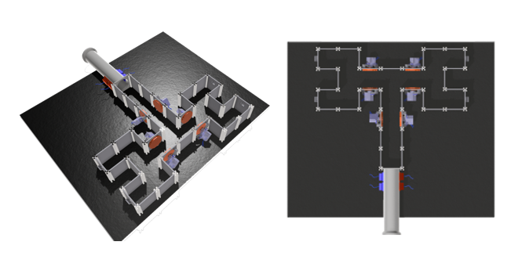

# The aMAZEing maze

**A modular, automated, sensory-engaging open-source platform for studying how sensory cues shape active exploration in rodents.**

[](LICENSE)
[](https://www.python.org/)
[](https://github.com/MaravallLab/aMAZEing-maze/actions/workflows/tests.yml)
[](https://maravalllab.github.io/aMAZEing-maze/)



The maze is a reconfigurable arena filmed under infrared light, built on a drilled floor plate so the walls move and the same rig becomes a different maze. Software tracks which arm the animal is in and drives the stimuli in real time. It runs two paradigms on the same hardware:

- **The auditory maze.** Entering an arm plays its sound. Nothing is rewarded; where the animal chooses to spend its time is the measurement.
- **The tactile maze.** A two-level decision tree cued by gratings read with the whiskers, with an automated, closed-loop pellet reward.

## Download

[](https://maravalllab.github.io/aMAZEing-maze/getting-started/download/)

Windows 10 or 11, no Python needed: download `amazeing-app.zip`, extract it and run `amazeing-app.exe`. The [download page](https://maravalllab.github.io/aMAZEing-maze/getting-started/download/) walks through it, including the Windows SmartScreen prompt on first launch.

## Documentation

Everything is on **[maravalllab.github.io/aMAZEing-maze](https://maravalllab.github.io/aMAZEing-maze/)**.

| If you want to | Start at |
|---|---|
| Run an auditory session | [Run your first session](https://maravalllab.github.io/aMAZEing-maze/getting-started/first-session/) |
| Run the tactile task | [The tactile paradigm](https://maravalllab.github.io/aMAZEing-maze/guide/tactile/) |
| Build a rig | [Build and set up the rig](https://maravalllab.github.io/aMAZEing-maze/hardware/build/) |
| Analyse recordings, or try it on demo data | [Analyse a set of sessions](https://maravalllab.github.io/aMAZEing-maze/analysis/tutorial/) |
| Reproduce the thesis analyses | [Reproduce the thesis](https://maravalllab.github.io/aMAZEing-maze/analysis/reproduce-thesis/) |
| Fix a problem | [Troubleshooting](https://maravalllab.github.io/aMAZEing-maze/reference/troubleshooting/) |

## Install from source

For the analysis scripts, for changing the code, or on macOS and Linux. The simplest way is [uv](https://docs.astral.sh/uv/), which fetches the right Python (3.13) and the exact library versions the code is tested with:

```bash
git clone https://github.com/MaravallLab/aMAZEing-maze.git
cd aMAZEing-maze
uv sync --extra all       # the application and the analysis pipelines
uv run amaze-app
```

Prefix any command with `uv run` (`uv run amaze-auditory ...`, `uv run python analysis/auditory/exp1_stimulus_pi.py ...`), or activate the environment once with `.venv\Scripts\activate` (Windows) or `source .venv/bin/activate` (macOS and Linux). Add `--extra bayes` for the Bayesian fits of the value model.

With pip instead, inside a Python 3.10 or later environment of your own (3.13 is the version tested):

```bash
pip install -e ".[all]"
```

The [installation page](https://maravalllab.github.io/aMAZEing-maze/getting-started/installation/) lists the command-line tools and the hardware, and [Troubleshooting](https://maravalllab.github.io/aMAZEing-maze/reference/troubleshooting/) covers the usual installation problems.

## Repository layout

| Folder | What it holds |
|---|---|
| `src/amazeing/` | The installable package: the auditory and tactile paradigms and the application |
| `analysis/` | The research pipelines, including every thesis analysis ([`analysis/README.md`](analysis/README.md)) |
| `hardware/`, `firmware/` | CAD sources, STLs and drawings; Arduino and MicroPython sketches |
| `docs/` | The documentation site |
| `packaging/` | The Windows application build |
| `tools/`, `tests/` | Utilities and the test suite |
| `archive/` | Superseded code, kept for reference |

## Contributing

Issues and pull requests are welcome. The [architecture page](https://maravalllab.github.io/aMAZEing-maze/development/architecture/) explains how the pieces fit together.

```bash
uv sync --extra all --extra dev --extra docs   # or: pip install -e ".[all,dev,docs]"
python -m pytest                  # the tests
mkdocs serve                      # preview the site at http://127.0.0.1:8000
python tools/make_screenshots.py  # regenerate the application screenshots
```

## Citing

The code that recorded the original behavioural experiments is tagged [`v1.0-thesis`](https://github.com/MaravallLab/aMAZEing-maze/releases/tag/v1.0-thesis). The analyses reported in the thesis are the scripts under `analysis/auditory/`, mapped figure by figure on [Reproduce the thesis](https://maravalllab.github.io/aMAZEing-maze/analysis/reproduce-thesis/).

## Contributors

Alejandra Carriero, Shahd Al Balushi, Andre Maia Chagas, Miguel Maravall, Oluwaseyi Jesusanmi, Yuri Elias Rodrigues, Maja Nowak, Marcus Burnell-Spector, Isabel Maranhao, Moira Eley.

## License

GPL-3.0-or-later. See [LICENSE](LICENSE).
