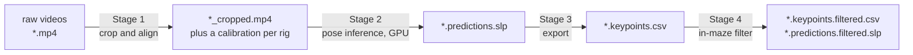

# Pose estimation pipeline

!!! info "At a glance"
    **Time:** an hour of setup and clicking; then days of unattended computing for a few hundred videos.
    **You need:** the session videos, an NVIDIA GPU, the trained sleap-nn models.
    **You get:** a CSV per video with ten keypoints of the mouse in every frame, with detections outside the maze removed.

## What it does

It turns raw ventral videos of the tactile maze into the position of the mouse's body parts in every frame. Each video is warped so the maze sits in one fixed place, a trained neural network predicts ten keypoints per frame, and a spatial filter removes confident but wrong detections outside the maze.



| Stage | Script | What it does |
|---|---|---|
| 1 | `analysis/crop_and_align_maze.py` | Warps every video so the maze sits in a fixed place ([its own page](crop-align.md)) |
| 2 | `analysis/sleap_batch_processing.py` | Predicts ten mouse keypoints per frame, and writes the CSV in the same pass |
| 3 | `analysis/slp_export.py` | Regenerates the CSV from the predictions, or draws an overlay video |
| 4 | `analysis/filter_in_maze.py` | Drops detections that fall outside the maze |

The ten keypoints are `nose`, `headbase`, `midbody`, `tailbase`, `midtail`, `endtail`, `LF_paw`, `RF_paw`, `LH_paw` and `RH_paw`.

## What you need

- **An NVIDIA GPU.** The CPU works but is far slower.
- **The trained models**: a folder holding a `*centroid*` and a `*centered_instance*` model subfolder.
- **sleap-nn**, the PyTorch version of SLEAP, installed as a [uv](https://docs.astral.sh/uv/) tool. Classic SLEAP (`pip install sleap`) will not load these models. One-time setup, in PowerShell:

    ```powershell
    powershell -c "irm https://astral.sh/uv/install.ps1 | iex"          # install uv
    uv tool install --python 3.13 "sleap-nn[torch]" --torch-backend auto
    sleap-nn system                                                      # should report your GPU
    ```

!!! warning "Run every stage with the sleap-nn Python"
    The most common failure is running a script with the wrong Python. A project virtual environment is often activated in the terminal and shadows everything else. Call the sleap-nn interpreter by its full path. Define it once per terminal:

    ```powershell
    $py = "$env:APPDATA\uv\tools\sleap-nn\Scripts\python.exe"
    & $py -c "import sleap_nn, torch; print(sleap_nn.__version__, torch.cuda.is_available())"
    ```

    The second line should print a version and `True`. Stage 1 needs only OpenCV, NumPy and pandas, which this interpreter also has, so `$py` works for every stage.

## Quick start

From the repository root, in PowerShell, with `<videos>` your raw videos, `<out>` the output folder and `<models>` the models folder:

```powershell
$py = "$env:APPDATA\uv\tools\sleap-nn\Scripts\python.exe"

# Stage 1: calibrate once per rig (click the 24 maze corners), then crop every video
& $py analysis\crop_and_align_maze.py --calibrate --input_dir <videos> --output_dir <out>
& $py analysis\crop_and_align_maze.py --input_dir <videos> --output_dir <out> --calibration_dir <out>

# Stage 2: predict keypoints (days; resumable)
& $py analysis\sleap_batch_processing.py --input_dir <out> --models_dir <models> --device cuda

# Stage 4: keep only detections on the maze
& $py analysis\filter_in_maze.py --input_dir <out> --calibration_dir <out> --save_overlays
```

Stage 3 is optional: Stage 2 already writes the CSV. Before trusting the numbers, open a few `*.maze_roi.png` files: the red outline should trace the maze.

!!! note "The one-command runner"
    `analysis/run_pipeline.py` and `analysis/run_pipeline.ps1` run Stages 2 and 4 in one go. They were written to sit at the repository root, and from `analysis/` they look for `analysis\analysis\...` and stop with `ERROR: missing script`. Run the stages as above until that is fixed.

## Details

### Stage 1: crop and align

Calibrate once per rig, by clicking the 24 maze corners on one clear frame; this writes `calibration.json` (and `calibration_rig2.json` and so on, for further rigs) into `<out>`. The batch then finds the maze in every video and warps it to a fixed frame, writing `<out>/<mouse>/<session>/<name>_cropped.mp4` and `<out>/alignment_summary.csv`.

Every rig's fixed frame has its own size, and the sizes differ, so later stages can tell a video's rig from the size of its cropped video. [Cropping and aligning the videos](crop-align.md) has everything else.

### Stage 2: pose inference

```powershell
& $py analysis\sleap_batch_processing.py --input_dir <out> --models_dir <models> --dry_run   # list what would run
& $py analysis\sleap_batch_processing.py --input_dir <out> --models_dir <models> --device cuda
```

For each `*_cropped.mp4` it writes `<name>_cropped.predictions.slp` and `<name>_cropped.keypoints.csv` beside the video, and `sleap_inference_summary.csv` in `<out>` at the end.

- **Resumable.** A video that already has its predictions is skipped (`--skip_existing`, on by default), so stop with Ctrl-C and run the same command again to continue.
- **Slow.** Reading the video, not the GPU, sets the pace: about 85 to 100 frames a second whatever the batch size, and each video has about 100,000 frames. A dataset of a few hundred videos takes days. Stop the computer sleeping (`powercfg /change standby-timeout-ac 0`) and count finished videos with `(Get-ChildItem <out> -Recurse -Filter *.predictions.slp).Count`.

??? note "All options of `sleap_batch_processing.py`"
    | Option | Meaning |
    |---|---|
    | `--input_dir DIR` | Folder searched for videos (required) |
    | `--models_dir DIR` | Folder holding the model subfolders; the newest `*centroid*` and `*centered_instance*` pair is used |
    | `--centroid_model DIR`, `--centered_instance_model DIR` | Name each model explicitly (overrides `--models_dir`) |
    | `--include_pattern GLOB` | Which files count as videos (default `*_cropped.mp4`) |
    | `--batch_size N` | Frames per batch (default 4) |
    | `--peak_threshold F` | Minimum peak confidence (default 0.2) |
    | `--max_instances N` | Mice per frame (default 1) |
    | `--device` | Where to run, for example `cuda` or `cpu` (default `auto`) |
    | `--prediction_suffix S` | Ending of the predictions file (default `.predictions.slp`) |
    | `--write_csv`, `--no-write_csv` | Write the per-frame CSV in the same pass (on by default) |
    | `--skip_existing`, `--no-skip_existing` | Skip videos already predicted (on by default) |
    | `--max_videos N` | Stop after N videos |
    | `--summary_csv PATH` | Where to write the summary |
    | `--dry_run` | List what would run, without running it |

### Stage 3: export (optional)

Use `slp_export.py` to regenerate the CSVs from the predictions, or to draw the keypoints on the video:

```powershell
& $py analysis\slp_export.py --input_dir <out>                                          # every CSV again
& $py analysis\slp_export.py --slp "<out>\...\<name>.predictions.slp" --render --render_frames 600
```

The CSV has one row per video frame, so the row number is the frame number:

```
frame_idx, instance_score, nose.x, nose.y, nose.score, headbase.x, ..., RH_paw.score
```

Points not found are blank (score 0.0); frames with no mouse are blank throughout. A full overlay video is about 700 MB, so `--render_frames N` keeps it to a short preview. Overlay videos use the `mp4v` codec; play them in VLC.

### Stage 4: keep only detections on the maze

The model's score is a confidence, not a check of correctness. When the mouse is absent, the model can place a confident pose on cables or reflections and score it above 0.9, so no score threshold removes these. The mouse can only be on the maze, so the filter drops any detection whose body falls outside the maze outline. The outline comes from the 24 calibration landmarks, which are already in the coordinates of the keypoints.

```powershell
& $py analysis\filter_in_maze.py --input_dir <out> --calibration_dir <out> --save_overlays
```

For each video it writes, without touching the original predictions:

- `<name>.predictions.filtered.slp`, the filtered predictions;
- `<name>.keypoints.filtered.csv`, the same format as Stage 3;
- `<name>.maze_roi.png` (with `--save_overlays`), the maze outline drawn on the video, to check it.

It prints how many detections it dropped:

```
rig=calibration size=362x322 | anchor=midbody margin=15px | detections=99986  dropped_off_maze=1519 (1.5%)
```

??? note "How the filter decides, and how to tune it"
    A detection is judged by its body centre (`--anchor`, default `midbody`), so an outstretched nose or tail does not pull it off the maze at the edges. It is dropped if either:

    - its body centre is more than `--margin_px` (default 15) outside the maze, at any confidence; or
    - its body centre is outside the maze at all and its score is below `--min_score_outside` (default 0.5).

    Real poses on the maze score about 0.91, false ones about 0.41, and a band of real poses at the edge (about 0.62) lies just outside the outline: the margin and the score cut keep those.

    Then an **absent-block sweep** (on by default): a confident detection inside a long run of mostly dropped frames is itself false and is dropped too. `--no_absent_block` turns it off; `--absent_block_window` and `--absent_block_min_presence` tune it.

    Tuning, erring toward keeping data:

    - Real poses dropped: raise `--margin_px` (for example 18) or lower `--min_score_outside` (for example 0.4).
    - More noise removal: lower `--margin_px` or raise `--min_score_outside`, watching the overlay, as real edge poses start to go around 0.6.
    - `--min_score_outside 0` uses geometry alone.
    - `--clip_points` also blanks single stray points outside the maze on detections that are kept.

??? note "Output files"
    For a source video `<name>_cropped.mp4`:

    | File | Stage | Contents |
    |---|---|---|
    | `<name>_cropped.predictions.slp` | 2 | Raw predictions |
    | `<name>_cropped.keypoints.csv` | 2 or 3 | Keypoints per frame, every detection |
    | `<name>_cropped.labeled.mp4` | 3 | Overlay video, if asked for |
    | `<name>_cropped.predictions.filtered.slp` | 4 | Predictions on the maze only |
    | `<name>_cropped.keypoints.filtered.csv` | 4 | Keypoints per frame, on the maze only |
    | `<name>_cropped.maze_roi.png` | 4 | The maze outline, to check |
    | `sleap_inference_summary.csv` | 2 | One row per video: status, run time, frames |

    Later stages never overwrite earlier outputs, so you can tune and run again safely.

??? note "Afterwards: keypoint-MoSeq"
    `analysis/kpms_split_bouts.py` trims the filtered keypoints to the stretches when the mouse is on the maze, before keypoint-MoSeq. Without it, the frames with no mouse (often half the recording or more) are interpolated into a frozen pose that the model learns as a behaviour. It has no command line; import `split_bouts` in the keypoint-MoSeq notebook, as its docstring shows.

## Troubleshooting

| Symptom | Cause | Fix |
|---|---|---|
| `No module named 'sleap_nn'` or `'torch'` | Wrong Python | Use `$py`, the full path, as above |
| `'sleap' is not installed` in Stage 2 | Same: the models are sleap-nn, not classic SLEAP | Use `$py` |
| `ERROR: missing script ...analysis\analysis\...` | `run_pipeline` looks one folder too deep | Run the stages one by one |
| Inference slow, GPU barely used | Reading the video sets the pace | Expected; a bigger `--batch_size` will not help. It is resumable |
| The filter drops a large share | Margin too tight, or the mouse really was off the maze | Look at `*.maze_roi.png` and an overlay video; raise `--margin_px` |
| `no rig polygon matches cropped size` | Calibration missing, or Stage 1 used another `--padding` | Point `--calibration_dir` at the folder with `calibration*.json`; pass the same `--padding` as in Stage 1 |
| An overlay video will not play | `mp4v` codec | Open it in VLC |

??? note "Words used on this page"
    - **`.slp`**: SLEAP's file of predictions and the video they belong to. Read it with `sleap-io`; everything else comes from it.
    - **score**: the confidence of a point or a pose, like the likelihood of DeepLabCut. A high score does not mean a correct pose, which is why Stage 4 exists.
    - **rig to outline**: each calibration warps the maze to a frame of its own size, so the size of a cropped video says which rig it came from, and the 24 landmarks are the maze outline.
    - **resumable**: Stages 1 and 2 skip work already done; Stages 3 and 4 only add files.
