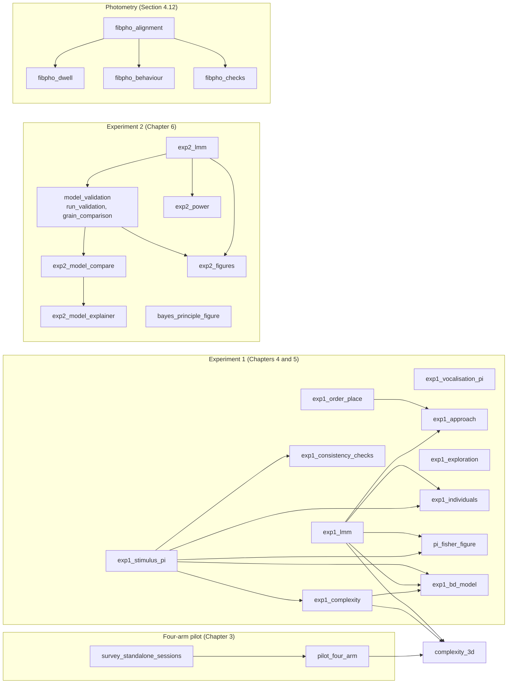

# Reproduce the thesis

This page maps every analysed figure and result of the thesis to the script that makes it, the command to run and the folder the output lands in. It mirrors the script index of Appendix C of the thesis (Table C.1), with the commands added.

!!! info "At a glance"
    **Time:** about an hour of computing for Experiment 1 and the pilot; Experiment 2 adds a few hours for the Bayesian fits.
    **You need:** the thesis data (available from the author on request), Python with the `[analysis]` extra, and R 4 for the mixed models.
    **You get:** every table, statistic and figure, in folders beside the data and, with `--thesis-figures`, in the thesis style.

## Before you start

1. Install the analysis dependencies from the repository root:

    ```bash
    pip install -e ".[analysis]"
    ```

2. Install R 4 with the packages `lme4`, `lmerTest` and `emmeans`. The scripts that fit mixed models find `Rscript` on the PATH, or in the newest R under `C:/Program Files/R`.
3. For the Bayesian fits of Experiment 2, install PyMC and ArviZ as the [value model quick guide](model-validation.md#5-how-to-run-it) describes.
4. Photometry needs the `tdt` package, which the `analysis` extra installs and the downloadable application includes.
5. Run every command from `analysis/auditory/`:

    ```bash
    cd analysis/auditory
    ```

The commands below use the folders of the lab analysis machine:

| Data | Folder in the commands |
|---|---|
| Experiment 1, the six stimulus sets | `D:/AuditoryExperiments/8_arms_w_voc` |
| Experiment 2, the grammar experiment | `D:/AuditoryExperiments/grammar` |
| The four-arm pilot, sessions loose at the top | `D:/AuditoryExperiments` |
| Photometry | `"D:/AuditoryExperiments/dopamine recordings"` |

Replace them with the place you put your copy. Every script takes its data folder on the command line, and writes its results under `BATCH_ANALYSIS/` in that folder (`FIBPHO_ANALYSIS/` for photometry), never inside a session folder. Add `--thesis-figures DIR` to a script that offers it to also write its figures, in the thesis fonts and sizes, into `DIR`.

Figure and section numbers are those of the thesis as built on 17 November 2026. The titles are given too, so a result can be found if a number moves.

## The order to run them in

Some scripts read the tables of others. An arrow means "run this first".



## Chapter 2: General methods

| Figure or result | Script | Command | Output in `BATCH_ANALYSIS/` |
|---|---|---|---|
| Figure 2.7, the preference index and its Fisher z (Section 2.5) | `pi_fisher_figure.py` | `python pi_fisher_figure.py D:/AuditoryExperiments/8_arms_w_voc` | `pi_fisher/` |
| The mixed models of visit length (Section 2.7) | `exp1_lmm.py`, `exp1_lmm.R` | `python exp1_lmm.py D:/AuditoryExperiments/8_arms_w_voc` | `lmm/` |
| Figure 2.8, the principle of Bayesian fitting (Section 2.7.2) | `bayes_principle_figure.py` | `python bayes_principle_figure.py` | `grammar/BATCH_ANALYSIS/bayes_principle/` |
| AIC and BIC of the nested value models (Section 2.7.2) | `exp2_model_compare.py` | `python exp2_model_compare.py D:/AuditoryExperiments/grammar` | `exp2_model/` |

??? note "Details"
    `pi_fisher_figure.py` reads the tables of `exp1_stimulus_pi.py` and `exp1_lmm.py`, so run those first. `bayes_principle_figure.py` reads no data: it is a schematic. Its one positional argument is the output folder, which defaults to `D:/AuditoryExperiments/grammar/BATCH_ANALYSIS/bayes_principle`.

## Chapter 3: The four-arm pilot

| Figure or result | Script | Command | Output |
|---|---|---|---|
| Which mice, which maze, which stimuli | `survey_standalone_sessions.py` | `python survey_standalone_sessions.py --root D:/AuditoryExperiments` | `D:/AuditoryExperiments_survey/` (`sessions.csv`, `blocks.csv`) |
| Figures 3.1 to 3.4 and every test of the chapter | `pilot_four_arm.py`, `pilot_lmm.R`, `stimulus_complexity.py` | `python pilot_four_arm.py --survey D:/AuditoryExperiments_survey` | `D:/AuditoryExperiments_survey/pilot/` (`stats.txt`, `lmm_results.txt`) |
| Figure 3.5, complexity in three dimensions | `complexity_3d.py` | `python complexity_3d.py` | `pilot/pilot_complexity_3d.html` |

??? note "Details"
    `survey_standalone_sessions.py` reads each pilot session on its own terms, because several versions of the code wrote them. `--out` sets where its tables go; by default they go in a folder beside the data, named after it with `_survey` added. `pilot_four_arm.py --thesis-figures DIR` also copies the figures into `DIR` under the names the thesis includes. `complexity_3d.py` also needs the output of `exp1_complexity.py` and `exp1_lmm.py` (see Chapter 4); its options are listed under [Stimulus measures](auditory.md#stimulus-measures).

## Chapter 4: Experiment 1

| Figure or result | Script | Command | Output in `8_arms_w_voc/BATCH_ANALYSIS/` |
|---|---|---|---|
| Figure 4.9, vocalisations and synthetic sounds (Section 4.4) | `exp1_vocalisation_pi.py` | `python exp1_vocalisation_pi.py D:/AuditoryExperiments/8_arms_w_voc` | `vocalisation_pi/` |
| Each stimulus against silence (Section 4.5); Figure 4.15, consonance and roughness (Section 4.7) | `exp1_stimulus_pi.py` | `python exp1_stimulus_pi.py D:/AuditoryExperiments/8_arms_w_voc` | `stimulus_pi/` |
| The mixed models behind Sections 4.4, 4.5 and 4.7 | `exp1_lmm.py`, `exp1_lmm.R` | `python exp1_lmm.py D:/AuditoryExperiments/8_arms_w_voc` | `lmm/` |
| Figure 4.10, each stimulus against silence mouse by mouse (Section 4.5); Figures 4.11 to 4.14, individual mice (Section 4.6) | `exp1_individuals.py`, `exp1_individuals.R` | `python exp1_individuals.py D:/AuditoryExperiments/8_arms_w_voc` | `individuals/` |
| Figure B.3, consonance mouse by mouse, and the place check (Sections 4.7 and 4.10) | `exp1_consistency_checks.py` | `python exp1_consistency_checks.py D:/AuditoryExperiments/8_arms_w_voc` | `consistency/` |
| Figures 4.16 and 4.18, stimulus complexity (Section 4.8) | `exp1_complexity.py`, `stimulus_complexity.py` | `python exp1_complexity.py D:/AuditoryExperiments/8_arms_w_voc` | `complexity/` |
| Figure 4.17, complexity in three dimensions (Section 4.8) | `complexity_3d.py` | `python complexity_3d.py` | `complexity/exp1_complexity_3d.html`, `complexity/stats_3d.txt` |
| Figures B.1 and B.2, complexity on the shuffled blocks alone | `exp1_complexity.py` | `python exp1_complexity.py D:/AuditoryExperiments/8_arms_w_voc --shuffled-only` | `complexity_shuffled/` |
| Figure 4.19, exploratory drive (Section 4.9) | `exp1_exploration.py` | `python exp1_exploration.py D:/AuditoryExperiments/8_arms_w_voc` | `exploration/` |
| Figures 4.20 and 4.21, day order and place (Section 4.10) | `exp1_order_place.py` | `python exp1_order_place.py D:/AuditoryExperiments/8_arms_w_voc` | `order_place/` |
| Figure 4.22, entering and staying (Section 4.11) | `exp1_approach.py`, `exp1_approach.R` | `python exp1_approach.py D:/AuditoryExperiments/8_arms_w_voc` | `approach/` |
| Figures 4.23 to 4.27, accumbens dopamine (Section 4.12) | `fibpho_*.py` | see [Photometry](#photometry-section-412) below | `FIBPHO_ANALYSIS/` |

??? note "Details"
    `exp1_stimulus_pi.py`, `exp1_complexity.py` and `exp1_lmm.py` take `--shuffled-only`, which leaves out the first sound block and writes to a folder with `_shuffled` added (`stimulus_pi_shuffled/`, `complexity_shuffled/`, `lmm_shuffled/`). The first sound block keeps the listed order by design, so a stimulus and a place go together in it; see [shuffled blocks](../reference/glossary.md#shuffled-blocks) in the glossary.

    `exp1_consistency_checks.py` reads `stimulus_pi/contrasts.csv`, so run `exp1_stimulus_pi.py` first. `--perms N` sets the number of permutations (default 10000).

    The second part of `exp1_complexity.py` reads the vocalisation recordings themselves, from the folders listed in `VOCALISATION_FOLDERS` at the top of the script, and skips that part if none of them exists.

## Chapter 5: The theory

| Figure or result | Script | Command | Output in `8_arms_w_voc/BATCH_ANALYSIS/` |
|---|---|---|---|
| Figure 5.1, the model of Brielmann and Dayan fitted to Experiment 1 (Section 5.1) | `exp1_bd_model.py` | `python exp1_bd_model.py D:/AuditoryExperiments/8_arms_w_voc` | `bd_model/` |

??? note "Details"
    Run `exp1_stimulus_pi.py`, `exp1_complexity.py` and `exp1_lmm.py` first; `exp1_bd_model.py` reads their tables.

## Chapter 6: Experiment 2

| Figure or result | Script | Command | Output in `grammar/` |
|---|---|---|---|
| The session-level preference, with place controlled (Section 6.6) | `exp2_lmm.py`, `exp2_lmm.R` | `python exp2_lmm.py D:/AuditoryExperiments/grammar` | `BATCH_ANALYSIS/exp2/` |
| The model-free design analysis and the Bayesian fits (Sections 6.6 and 6.7) | `model_validation/` | see [Running the value model](#running-the-value-model) below | `model_validation_output/` |
| AIC and BIC of the nested models (Section 6.7) | `exp2_model_compare.py` | `python exp2_model_compare.py D:/AuditoryExperiments/grammar` | `BATCH_ANALYSIS/exp2_model/` |
| Figure B.4, how the model is fitted, step by step | `exp2_model_explainer.py` | `python exp2_model_explainer.py D:/AuditoryExperiments/grammar` | `BATCH_ANALYSIS/exp2_model/` |
| Figures 6.1 to 6.3, the stimuli, the preference and the model (Sections 6.2, 6.6 and 6.7) | `exp2_figures.py` | `python exp2_figures.py D:/AuditoryExperiments/grammar --thesis-figures <thesis>/figures` | the folder given to `--thesis-figures` |

### Running the value model

`exp2_figures.py` and `exp2_model_explainer.py` read `model_validation_output/` inside the grammar folder. Write the Bayesian fits there:

```bash
python model_validation/run_validation.py --results_dir D:/AuditoryExperiments/grammar --out_dir D:/AuditoryExperiments/grammar/model_validation_output --day both --emission tier_restricted --phase2 --draws 1000 --tune 2000 --chains 4 --target-accept 0.95
python model_validation/grain_comparison.py D:/AuditoryExperiments/grammar D:/AuditoryExperiments/grammar/model_validation_output
```

The options are the ones the thesis run recorded in its `results.json`. The [value model quick guide](model-validation.md) explains them, and the compiler setup PyMC needs on Windows.

??? note "Details"
    `exp2_figures.py` requires `--thesis-figures`; it reads `BATCH_ANALYSIS/exp2/arm_blocks.csv` (from `exp2_lmm.py`) and `model_validation_output/results.json` and `grain_results.json`. `exp2_model_explainer.py` reads `model_validation_output/results.json` and `BATCH_ANALYSIS/exp2_model/information_criteria.csv`, so run `exp2_model_compare.py` first.

    The `exp2_*` scripts read `model_validation/` (its data loading, exclusions and features) but never change it or its outputs.

## Chapter 7: Discussion

| Figure or result | Script | Command | Output in `grammar/BATCH_ANALYSIS/` |
|---|---|---|---|
| Sample size and power (Section 7.2.3) | `exp2_power.py` | `python exp2_power.py D:/AuditoryExperiments/grammar` | `exp2/power.txt` |

??? note "Details"
    The third part of `exp2_power.py` resamples the mice and needs `exp2/arm_blocks.csv` from `exp2_lmm.py`. Without it the script uses the effect sizes given by `--dz` (day 1, default 0.69) and `--dz-day2` (default 0.57). `--sims N` sets the number of simulations (default 20000).

## Photometry (Section 4.12)

`fibpho_alignment.py` runs first; the others read the `FIBPHO_ANALYSIS/` folder it writes.

| Figure or result | Script | Command | Output in `FIBPHO_ANALYSIS/` |
|---|---|---|---|
| The aligned recordings and delta F/F | `fibpho_alignment.py` | `python fibpho_alignment.py "D:/AuditoryExperiments/dopamine recordings"` | `<day>/<mouse>/`, `alignment_summary.csv` |
| Figures 4.23 to 4.26, dopamine around each visit | `fibpho_dwell.py` | `python fibpho_dwell.py "D:/AuditoryExperiments/dopamine recordings/FIBPHO_ANALYSIS"` | `dwell/` |
| Figure 4.27, dopamine across exposures | `fibpho_behaviour.py` | `python fibpho_behaviour.py "D:/AuditoryExperiments/dopamine recordings/FIBPHO_ANALYSIS"` | `behaviour/` |
| Checks on the signal around arm entries | `fibpho_checks.py` | `python fibpho_checks.py "D:/AuditoryExperiments/dopamine recordings"` | `checks/` |

??? note "Details"
    `fibpho_alignment.py --out DIR` writes somewhere other than `FIBPHO_ANALYSIS/`. `fibpho_checks.py` takes the `dopamine recordings` folder itself, unlike the other three. The [photometry section](auditory.md#photometry) of the thesis scripts page explains how the two clocks are aligned.

## Checks the thesis does not cite

These run on the same data and are kept because they answer questions raised along the way.

| Script | Question | Output in `BATCH_ANALYSIS/` |
|---|---|---|
| `fisher_z_check.py` | Does analysing the index on its Fisher z scale change any result? | `fisher_z_check/` |
| `exp2_model_check.py` | Could place alone produce the semantic weight? | `exp2_model/` |
| `fibpho_arms.py`, `fibpho_dynamics.py` | Dopamine in each arm, and how responses change within and across blocks | `FIBPHO_ANALYSIS/arms/`, `FIBPHO_ANALYSIS/dynamics/` |

## Which code recorded the data

Experiment 1 was recorded with the original version of the software, whose final state is commit `d5f5a63`. Experiment 2 was recorded with the version tagged [`v1.0-thesis`](https://github.com/MaravallLab/aMAZEing-maze/releases/tag/v1.0-thesis). The analysis scripts on this page are the current ones in `analysis/auditory/`.
