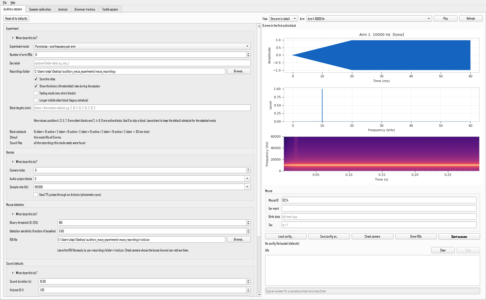

# Download the application

The application runs on Windows 10 or 11 with nothing else installed: Python and every library come inside the download.

[:material-download: Download amazeing-app.zip](https://github.com/MaravallLab/aMAZEing-maze/releases/latest/download/amazeing-app.zip){ .md-button .md-button--primary }
[All releases](https://github.com/MaravallLab/aMAZEing-maze/releases){ .md-button }

!!! info "At a glance"
    **Time:** about five minutes, most of it the download (around 200 MB).
    **You need:** a Windows 10 or 11 computer. No administrator rights, no Python.
    **You get:** the aMAZEing maze window, ready to design a session.

## Step 1: Download

Click **Download amazeing-app.zip** above. Your browser saves it to your Downloads folder.

??? question "The link says Not Found"
    No release has been published yet. Until one is, install [from source](installation.md#from-source), or ask the lab for a copy of the zip.

## Step 2: Unzip it

1. Open your Downloads folder.
2. Right-click `amazeing-app.zip` and choose **Extract All...**.
3. Choose a permanent place, such as `C:\amazeing-app`, and click **Extract**.

!!! warning "Do not run it from inside the zip"
    Double-clicking the zip only shows its contents; Windows has not unpacked them. The application must be extracted first. Keep the `_internal` folder beside `amazeing-app.exe`: it holds Python and every library, and the program will not start without it. To move the application, move the whole folder.

Avoid a folder synchronised by OneDrive or Box. Synchronisation can hold files the program needs, and the folder holds several thousand of them.

## Step 3: First launch

Open the folder you extracted to, then the `amazeing-app` folder inside it, and double-click `amazeing-app.exe`.

### If Windows says it protected your PC

The application is not signed with a paid certificate, so Windows does not recognise it and shows a blue box headed **Windows protected your PC**.

1. Click **More info**.
2. Check that the app named is `amazeing-app.exe`.
3. Click **Run anyway**.

Windows remembers the choice, so this happens only the first time.

## Step 4: What you should see

The first start can take up to a minute while Windows checks the new files; later starts take a few seconds. A window opens with the title **aMAZEing maze** and its version number, and five tabs along the top:

| Tab | What it is for |
|---|---|
| Auditory session | Design and run an auditory session |
| Speaker calibration | The frequency response curve used to equalise the stimuli |
| Analysis | Figures and tables from recorded sessions |
| Grammar training | Continuous grammar playback for training days |
| Tactile session | Launch the tactile task |



That is all. Next, [run your first session](first-session.md).

## If it fails

??? question "Nothing happens when I double-click"
    The program is starting in the background. Wait a minute, as the first start is slow. If no window has appeared after that, check the points below.

??? question "It says a file or DLL is missing"
    The `_internal` folder is not beside `amazeing-app.exe`. Extract the whole zip again (Step 2) and start the program from the extracted folder, not from inside the zip.

??? question "My antivirus removed or blocked it"
    Some antivirus programs distrust any unsigned program that bundles Python. Restore the file from the antivirus quarantine, or ask your IT team to allow the `amazeing-app` folder.

??? question "There is no Run anyway button"
    Your organisation's policy blocks unrecognised programs. Ask your IT team to allow `amazeing-app.exe`, or install [from source](installation.md#from-source) instead.

??? question "Check that the program works without opening the window"
    Open a Command Prompt in the `amazeing-app` folder (type `cmd` in the address bar of File Explorer and press Enter), then run:

    ```bat
    amazeing-app.exe --entry auditory --write-config check.yaml
    ```

    Wait a few seconds. If `check.yaml` appears in the folder, the bundled Python and libraries work, and the problem is with the window. Note the exact message you saw and [open an issue](https://github.com/MaravallLab/aMAZEing-maze/issues).

More problems and their fixes are gathered on the [troubleshooting page](../reference/troubleshooting.md).

## Updating

Download the new zip and extract it to a new folder, or delete the old folder first. Sessions are saved outside the application folder (by default in `Desktop\auditory_maze_experiments\maze_recordings`), and configuration files wherever you chose to save them, so neither is affected.

## Other systems

There is no download for macOS or Linux. Install [from source](installation.md#from-source); the analysis works on both, and the sessions should, though no one has run animals on them.
